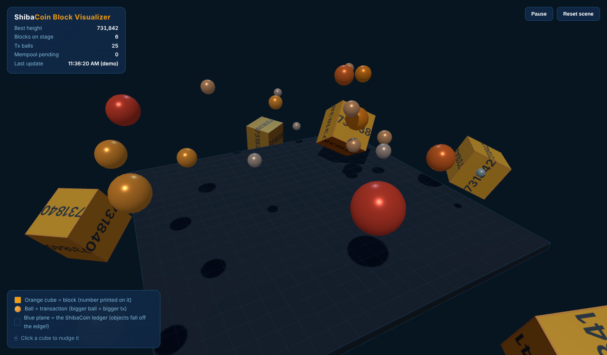

# ShibaCoin Block Visualizer

A live 3D view of the ShibaCoin blockchain. Every new block drops onto a blue
"ledger" plane as an orange cube with its block height printed on it, and each
transaction drops beside it as a ball sized and coloured by how big it is.
Everything is real physics, so cubes tumble, balls bounce, and anything that
rolls off the edge falls into the void.



It's three small files with no build step and no `npm install`. A tiny Node.js
server reads the chain from your own ShibaCoin node via `shibacoin-cli`, and
the browser draws it with [three.js](https://threejs.org) and
[cannon-es](https://github.com/pmndrs/cannon-es).

---

## Contents

- [What you'll see](#what-youll-see)
- [How it works](#how-it-works)
- [Requirements](#requirements)
- [Quick start](#quick-start)
- [Configuration](#configuration)
- [Connecting to your node](#connecting-to-your-node)
- [Keep it running (PM2 or systemd)](#keep-it-running)
- [Put it on the web (nginx, Caddy, HTTPS)](#put-it-on-the-web)
- [Checking it works](#checking-it-works)
- [API](#api)
- [Troubleshooting](#troubleshooting)
- [Customising](#customising)
- [Security notes](#security-notes)
- [License](#license)

---

## What you'll see

| Thing | Meaning |
| --- | --- |
| **Orange cube** | A block. The height is printed on every face; cube size grows slightly with the block's size in bytes. |
| **Ball** | A transaction (mined or still pending in the mempool). The coinbase is skipped. |
| **Ball size and colour** | Transaction size on a log scale from 150 B to 20 kB. A 250 B payment is a small light-blue marble, ~1.7 kB is orange, 20 kB+ is a big red ball. |
| **Blue plane** | The ledger. Objects that roll off the edge are removed. |

- The **HUD** (top left) shows the best block height, what's on stage, pending
  mempool transactions and the last update time.
- **Pause** freezes the physics; **Reset scene** clears the stage (only blocks
  and transactions that arrive afterwards are dropped).
- **Click a cube** to give it a nudge.
- At most 30 balls are dropped per block (the largest transactions) and at most
  350 objects are kept on stage, so busy blocks don't overwhelm the browser.

### Demo mode

ShibaCoin can be quiet: many blocks contain only the coinbase, so on a calm
day you'll see cubes falling without any balls. Add `?demo=1` to the URL to see
the full effect with synthetic data: 6 blocks with random transactions up
front, then a new one every 10 seconds. Demo mode reads your node's best height
once (so the numbers look right) and ignores live data after that.

---

## How it works

```
 shibacoind  <──  shibacoin-cli  <──  server.js (Node, port 3002)  <──  browser (index.html)
 (your node)      (read-only calls)   polls every 6 s, keeps the       polls /api/state every 6 s,
                                      last 6 blocks + mempool          drops cubes and balls
```

`server.js` runs `shibacoin-cli` as a child process. It never talks to the
node's RPC port directly and never touches a wallet. It uses only these
read-only commands:

`getblockcount`, `getblockhash`, `getblock`, `getrawtransaction`, `getrawmempool`

---

## Requirements

- **A synced ShibaCoin full node** (`shibacoind`) on the same machine, with RPC
  enabled so `shibacoin-cli` works (`server=1` in your `shibacoin.conf`).
- **`shibacoin-cli`** on that machine. Check with:
  ```bash
  shibacoin-cli getblockcount
  ```
  If that prints a number, you're good.
- **Node.js 18 or newer.** No npm packages are needed.
- **Viewers' browsers need internet access to `esm.sh`**, where three.js and
  cannon-es are loaded from. To avoid that, see
  [Hosting the libraries yourself](#hosting-the-libraries-yourself).
- *Optional:* `txindex=1` on the node. Only needed for accurate ball sizes on
  nodes that don't support `getblock <hash> 2`. See
  [Transaction sizes and txindex](#transaction-sizes-and-txindex).

---

## Quick start

```bash
# 1. Get the code
git clone https://github.com/ShibaCoinPOW/blockvisualizer.git
cd blockvisualizer

# 2. Run it (as the same Linux user that runs shibacoind; see "Connecting to your node")
SHIBACOIN_CLI=$(which shibacoin-cli) node server.js
```

You should see:

```
[blockvisualizer] starting on http://127.0.0.1:3002
[blockvisualizer] using shibacoin-cli at /usr/local/bin/shibacoin-cli
[blockvisualizer] getblock verbosity 2 supported
[blockvisualizer] polling every 6000ms; current bestHeight=731842
```

Then open **http://127.0.0.1:3002/** in a browser on the same machine. Try
**http://127.0.0.1:3002/?demo=1** too.

**Running it on a remote server?** By default the server only listens on
`127.0.0.1`, so it isn't reachable from outside. To look at it from your own
computer without opening any ports, use an SSH tunnel:

```bash
ssh -L 3002:127.0.0.1:3002 you@your-server
# then browse to http://127.0.0.1:3002/ on your own computer
```

When you're ready to make it public, see [Put it on the web](#put-it-on-the-web).

---

## Configuration

All settings are environment variables:

| Variable | Default | What it does |
| --- | --- | --- |
| `PORT` | `3002` | Port the server listens on. |
| `HOST` | `127.0.0.1` | Address to listen on. Keep `127.0.0.1` behind a reverse proxy; use `0.0.0.0` only if you want it reachable directly (e.g. on a home LAN). |
| `SHIBACOIN_CLI` | `/usr/local/bin/shibacoin-cli` | Full path to `shibacoin-cli`. Run `which shibacoin-cli` to find it. |
| `SHIBACOIN_CLI_ARGS` | *(empty)* | Extra arguments put before every CLI call, e.g. `-conf=/path/to/shibacoin.conf` or `-datadir=/path/to/datadir`. Separated by spaces; quoting isn't supported, so avoid paths with spaces. |
| `POLL_MS` | `6000` | How often the server polls the node, in milliseconds. The browser polls every 6 s; if you change this, also change `setInterval(refreshState, 6000)` in `public/index.html`. |

Example:

```bash
PORT=8080 SHIBACOIN_CLI=/opt/shibacoin/bin/shibacoin-cli \
SHIBACOIN_CLI_ARGS="-datadir=/var/lib/shibacoin" node server.js
```

Fine-tuning constants (blocks kept, balls per block, object limits) live at the
top of `server.js` and `public/index.html`; see [Customising](#customising).

---

## Connecting to your node

`shibacoin-cli` needs the node's RPC credentials, which it reads from the
node's config file or cookie in its data directory. Pick one:

1. **Easiest: run the visualizer as the same Linux user that runs
   `shibacoind`.** `shibacoin-cli` then finds everything on its own, exactly as
   when you run it by hand.
2. **Run it as a different user** and point the CLI at the node's config with
   `SHIBACOIN_CLI_ARGS="-conf=/path/to/shibacoin.conf"` (or `-datadir=...`).
   That user needs read access to the file.

Avoid putting `-rpcpassword=...` in `SHIBACOIN_CLI_ARGS`: command-line
arguments are visible to every user on the machine via `ps`. Use `-conf`
instead.

A quick test as the user that will run the visualizer:

```bash
sudo -u shibacoin /usr/local/bin/shibacoin-cli getblockcount
```

### Transaction sizes and txindex

To size each transaction the server tries, in order:

1. **`getblock <hash> 2`**: one call returns every transaction with its size,
   and no `txindex` is needed. The server checks on the first block whether
   your node supports it and reports the result in `/api/health` as
   `getblockVerbosity2`.
2. **The size seen while the transaction was pending** in the mempool (kept in
   memory after it's mined).
3. **`getrawtransaction <txid> 1`**, at most 200 per block. For mined
   transactions this only works if the node runs with **`txindex=1`**.
   Failures are counted in `/api/health` as `txLookupFailures`, logged once,
   and those balls are drawn at a 250 B placeholder size.

So if `getblockVerbosity2` is `true`, you don't need `txindex`. If it's
`false` and `txLookupFailures` keeps growing, either add `txindex=1` to
`shibacoin.conf` (this needs a one-off reindex of the node, which can take a
while) or accept placeholder sizes for transactions the server didn't see in
the mempool.

---

## Keep it running

Pick **one** of these.

### Option A: PM2

```bash
sudo npm install -g pm2          # once
cd /usr/src/blockvisualizer       # or wherever you cloned it
nano ecosystem.config.js         # check SHIBACOIN_CLI, PORT, etc.
pm2 start ecosystem.config.js
pm2 save
pm2 startup                      # prints a command that makes PM2 start at boot; run it
```

Useful commands:

```bash
pm2 logs shibacoin-blockvisualizer
pm2 restart shibacoin-blockvisualizer --update-env   # after editing ecosystem.config.js
pm2 status
```

Keep `instances: 1`. The server holds its state in memory, so it can't run as
a cluster.

### Option B: systemd

```bash
sudo cp examples/shibacoin-blockvisualizer.service /etc/systemd/system/
sudo nano /etc/systemd/system/shibacoin-blockvisualizer.service   # set User, WorkingDirectory, paths
sudo systemctl daemon-reload
sudo systemctl enable --now shibacoin-blockvisualizer
journalctl -u shibacoin-blockvisualizer -f
```

The example unit runs as user `shibacoin` from `/usr/src/blockvisualizer`
and includes some basic sandboxing. Adjust `User`, `WorkingDirectory`, the
`node` path (`which node`) and the `Environment=` lines to match your server.

---

## Put it on the web

Keep the visualizer on `127.0.0.1` and let a web server handle the public side
and HTTPS. The page uses relative URLs, so it works at a domain root
(`https://blocks.example.org/`) or under a sub-path
(`https://example.org/blocks/`).

### nginx

See [`examples/nginx.conf`](examples/nginx.conf) for both layouts. The sub-path
version looks like this, inside your existing `server { }` block:

```nginx
location = /blocks { return 301 /blocks/; }

location /blocks/ {
    proxy_pass http://127.0.0.1:3002/;   # trailing slash strips /blocks
    proxy_http_version 1.1;
    proxy_set_header Host              $host;
    proxy_set_header X-Forwarded-For   $proxy_add_x_forwarded_for;
    proxy_set_header X-Forwarded-Proto $scheme;
}
```

Two details matter:

- **The trailing slashes.** `proxy_pass http://127.0.0.1:3002/;` strips the
  `/blocks` prefix, and the `301` makes sure visitors land on `/blocks/` (with
  the slash), otherwise the page's API calls go to the wrong place.
- **Put it above any catch-all `location /`** (for example one that proxies to
  your main website).

Then `sudo nginx -t && sudo systemctl reload nginx`. For HTTPS on a dedicated
subdomain: `sudo certbot --nginx -d blocks.example.org`.

### Caddy

Caddy gets HTTPS certificates automatically:

```caddy
blocks.example.org {
    reverse_proxy 127.0.0.1:3002
}
```

Or under a sub-path of an existing site:

```caddy
example.org {
    redir /blocks /blocks/
    handle_path /blocks/* {
        reverse_proxy 127.0.0.1:3002
    }
    # ... the rest of your site
}
```

---

## Checking it works

```bash
curl -sS http://127.0.0.1:3002/api/health
```

```json
{
  "ok": true,
  "bestHeight": 731842,
  "starts": 1,
  "blocksServed": 4,
  "txsServed": 0,
  "mempoolServed": 0,
  "txLookupFailures": 0,
  "getblockVerbosity2": true,
  "lastPollAt": "2026-10-15T18:36:17.673Z",
  "lastError": null
}
```

- `bestHeight` should match `shibacoin-cli getblockcount`.
- `lastPollAt` should be a few seconds old at most.
- `lastError` is `null` when the last poll went cleanly; otherwise it holds the
  most recent error.
- `getblockVerbosity2` and `txLookupFailures`: see
  [Transaction sizes and txindex](#transaction-sizes-and-txindex).

---

## API

All responses are JSON with `Cache-Control: no-store`.

| Path | Returns |
| --- | --- |
| `GET /` | The visualizer page. `?demo=1` for demo mode. |
| `GET /api/state` | `{ bestHeight, recentBlocks, mempool, txCount, mempoolCount, stats }`. `recentBlocks` holds the last 6 blocks, each with up to 30 largest transactions; `txCount` is the number of transaction sizes in the server's cache (not a chain statistic). |
| `GET /api/block/:height` | One block in the same shape as `recentBlocks` entries. `400` for a bad height, `404` above the best known height, `503` with `Retry-After` while the server is starting or already busy with two uncached lookups. |
| `GET /api/health` | `{ ok, bestHeight, ...stats }` (see above). |

---

## Troubleshooting

| Symptom | Likely cause and fix |
| --- | --- |
| `lastError` mentions `ENOENT` | `SHIBACOIN_CLI` points to the wrong place. Use the output of `which shibacoin-cli`. |
| `lastError` says the CLI couldn't connect, or mentions RPC credentials or authorization | `shibacoind` isn't running, RPC isn't enabled (`server=1`), or the visualizer runs as a user that can't read the node's config. See [Connecting to your node](#connecting-to-your-node). |
| `lastError` contains `timeout` | The node is too busy to answer within 8 s (e.g. still syncing or reindexing). It recovers on its own once the node catches up. |
| Red "Lost connection to visualizer server" banner in the page | The browser can't reach `api/state`. Check the server is running, and if it's behind a sub-path, that the URL ends in `/` (see [nginx](#nginx)). |
| Blank dark page, nothing renders | The browser couldn't load three.js/cannon-es from `esm.sh` (blocked network, strict firewall or content blocker). Check the browser console, or [host the libraries yourself](#hosting-the-libraries-yourself). |
| Cubes fall but no balls | Normal on a quiet chain: the blocks only contain the coinbase, which isn't drawn. Use `?demo=1` to see transactions. |
| All balls are the same small size | Sizes are falling back to placeholders. Check `getblockVerbosity2` and `txLookupFailures` in `/api/health`; see [txindex](#transaction-sizes-and-txindex). |
| Works on the server itself but not from outside | Expected: it listens on `127.0.0.1`. Use an [SSH tunnel](#quick-start), a [reverse proxy](#put-it-on-the-web), or `HOST=0.0.0.0` on a trusted network. |

Logs: `pm2 logs shibacoin-blockvisualizer`, or
`journalctl -u shibacoin-blockvisualizer` with systemd.

---

## Customising

### Look and feel

Colours are defined twice in `public/index.html`: as CSS variables at the top
of the `<style>` block (HUD, buttons, legend) and in the `COLOR` object in the
script (3D scene). The block number texture is drawn in `makeNumberTexture`.
Don't make the cube material transparent; the orange is painted into the
texture, and transparency turns the cube into floating digits.

### Scene and physics (`public/index.html`)

| Constant | Default | Meaning |
| --- | --- | --- |
| `PLANE_HALF` | `22` | Half the width of the plane. |
| `MAX_OBJECTS` | `350` | Most objects on stage; the oldest balls are removed first. |
| `GRAVITY` | `-22` | Gravity. |
| `TX_LOG_MIN` / `TX_LOG_MAX` | 150 B / 20 kB | Transaction size range for ball size and colour. |
| `DEMO_BLOCK_MS` | `10000` | How often demo mode adds a block. |

### Server (`server.js`)

| Constant | Default | Meaning |
| --- | --- | --- |
| `RECENT_BLOCK_CACHE` | `6` | Recent blocks kept and sent to browsers. |
| `MAX_TX_PER_BLOCK` | `30` | Balls per block (largest transactions). |
| `MAX_MEMPOOL_ENTRIES` | `100` | Pending transactions tracked. |
| `MAX_TX_LOOKUPS_PER_BLOCK` | `200` | Cap on per-transaction lookups for one block. |
| `TX_FETCH_CONCURRENCY` | `4` | Parallel `shibacoin-cli` calls. |

### Hosting the libraries yourself

To serve three.js and cannon-es from your own server instead of `esm.sh`
(offline networks, privacy, or strict content policies):

```bash
mkdir -p public/vendor
curl -L -o public/vendor/three.module.js https://unpkg.com/three@0.160.0/build/three.module.js
curl -L -o public/vendor/cannon-es.js     https://unpkg.com/cannon-es@0.20.0/dist/cannon-es.js
```

Then change the import map in `public/index.html` to:

```html
<script type="importmap">
{
  "imports": {
    "three": "./vendor/three.module.js",
    "cannon-es": "./vendor/cannon-es.js"
  }
}
</script>
```

The server already serves anything under `public/`.

---

## Security notes

- The visualizer is **read-only**. It runs only the five `shibacoin-cli`
  commands listed under [How it works](#how-it-works) and never calls wallet
  commands.
- It listens on **`127.0.0.1` by default**. Put a reverse proxy in front rather
  than exposing the port.
- `/api/block/:height` is the only route that can trigger extra node work on
  request. It validates the height, caches results, and runs at most two
  uncached lookups at a time.
- API responses send `Access-Control-Allow-Origin: *`, so other websites can
  read the (public) chain data it serves. Remove that header in `send()` in
  `server.js` if you don't want that.
- Run it as an unprivileged user, not root. The example systemd unit adds some
  sandboxing on top.

---

## License

[MIT](LICENSE)
